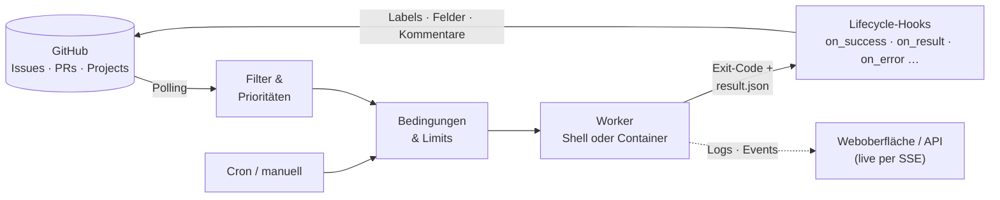

# Agent Dispatch Daemon (`adispatchd`)

[](https://github.com/brokoskokoli/adispatchd/actions/workflows/ci.yml)
[](https://www.npmjs.com/package/adispatchd)
[](https://nodejs.org/)
[](LICENSE)

[English](README.md) · **Deutsch** · [Website](https://brokoskokoli.github.io/adispatchd/)

**Aus GitHub-Issues werden Runs deiner Shell-Skripte und KI-Agenten – deklarativ, nachvollziehbar, auf deinem eigenen Rechner.**

Konfigurationsgetriebener Orchestrator für Shell-Prozesse und KI-Agenten. Er findet Aufgaben in externen Quellen
(V1: GitHub Issues/PRs), wählt sie über Filter und Prioritäten aus, prüft Startbedingungen, führt unabhängige
Shell-Workflows in eigenen Workspaces aus, überwacht und protokolliert jeden Run, führt Lifecycle-Aktionen aus
(Labels, GitHub-Projects-Felder, Kommentare, Shell-Hooks) und zeigt alles in einer kleinen Weboberfläche mit
Live-Updates.

## Warum

Wer Coding- oder Review-Agenten auf einen Issue-Tracker loslässt, landet meist bei einem Haufen Cronjobs und
Klebeskripten: Wer nimmt welches Issue, was passiert bei einem Absturz, wer setzt die Labels zurück, wo liegen die
Logs? `adispatchd` verlegt diese Entscheidungen in wenige YAML-Dateien und hält die Worker einfach:

- **GitHub bleibt Source of Truth** – kein eigener Ticketstore; SQLite hält nur Runs, Locks, Events, Blocks, Aktionsjournale.
- **Worker sind normale Programme** – alles, was Umgebungsvariablen liest und mit einem Exit-Code endet: Shell-Skript,
  CLI-Agent, Container.
- **Fehler sind eingeplant** – technische Fehler (Absturz, Timeout, Abbruch) und fachliche Ergebnisse („braucht den
  Maintainer“) sind getrennt und haben eigene Hooks.

## Funktionen

- **Unabhängige Workflows** mit Source-, Cron- oder manuellem Trigger, globalen und workflowbezogenen Limits; ein
  Workflow kann **mehrere Repositories** bedienen (`sources: [...]`, optional Limit je Source), Unterschiede je
  Repository stehen als Variablen an der Source (`{source.vars.base_branch}`).
- **Deklarative Filter und Prioritäten** auf Labels, Zustand, Milestone, Issue-Typ, native Abhängigkeiten („blocked by“)
  und Felder aus **GitHub Projects** (Status, Priorität, eigene Felder; „A oder B“ per `in`) – fehlender Zugriff ergibt
  `unknown` statt eines falschen Starts. **Benannte Filter** (`filters/<id>.yaml`) einmal definieren, überall verwenden.
- **Sichtbare Startbedingungen:** Shell-Prüfungen (`conditions`, `shell_filter`) bekommen optionale Namen; die UI zeigt
  jede Prüfung mit ihrem letzten Ergebnis (ok / nicht jetzt / Prüffehler, Zeitpunkt, Cache, erste stderr-Zeile) und je
  Planungsschritt, wie viele Items die Item-Prüfungen bestanden haben.
- **Info-Kacheln im Dashboard:** `dashboard.yaml` definiert kleine Skripte (Text, Zahl oder Prozent mit Warn- und
  Kritisch-Schwellen), die der Daemon im Hintergrund nach Cache-Ablauf ausführt – z. B. Plattenbelegung, offene PRs,
  Guthaben.
- **Arbeits-Branch und PR eines Issues** als Felder (`work_branch`, `work_pr`, `linked_branches`, `closing_prs`):
  filtern („hat offenen PR“), in Views mit Link auf den PR anzeigen und per `{item.work_branch}`/`{item.work_pr}`
  direkt an Worker und Actions übergeben – frisch gelesen, nie leer geraten, wenn GitHub sie nicht liefern kann.
- **Lifecycle-Aktionen** setzen Labels und **Projektfelder** (z. B. `Status: In Progress` beim Start, `Review` nach
  Erfolg; Items werden bei Bedarf dem Projekt hinzugefügt), schreiben Kommentare und rufen Shell-Hooks auf –
  idempotent (erst lesen, dann schreiben) mit Journal und Retries.
- **Mehr als zwei Ausgänge:** benannte Ergebnisse (`outcome` in der Ergebnisdatei → `on_result.<outcome>`) und ein
  Sammel-Hook `on_error` für alle technischen Ausgänge.
- **Worker im Container:** `execute.type: container` startet den Worker in einem Wegwerf-Container (Docker oder
  Podman) mit festen Mounts für Workspace, Kontext, Ergebnis und Token-Dateien, Ressourcenlimits, `--cap-drop ALL` –
  Secrets nie auf der Kommandozeile; Cancel/Timeout stoppen den Container, nach einem Neustart räumt die Recovery
  verwaiste Container dieser Instanz weg.
- **Tokens für lange Runs:** Secrets per Umgebungsvariable oder als **Token-Datei** (`delivery: file` →
  `<NAME>_FILE`), die der Daemon vor Ablauf atomar erneuert und nach dem Run löscht – Worker brauchen keine
  App-Schlüssel. Shell-Actions in Hooks können ebenfalls Tokens anfordern.
- **Dateien sichern:** `execute.keep` kopiert Mitschnitte und Logs (Glob-Muster) vor dem Workspace-Cleanup nach
  `runs/<run-id>/kept/` – mit Größenlimit, ohne Symlinks zu folgen; Download in UI und API, gelöscht mit dem Run.
- **Weboberfläche mit Live-Updates** (SSE): Workflows, Runs mit Live-Output, Events und gesicherten Dateien, Views
  über mehrere Repositories; dazu eine JSON-HTTP-API.
- **Server-Ressourcen im Dashboard:** CPU über die Zeit, gestapelt nach Daemon, jedem Run (Klick → Run), Hooks/Checks
  und den größten fremden Prozessen, dazu RAM, Load und freier Plattenplatz; Messwerte nur im Speicher (`monitoring` in
  `config.yaml`), gezeigt werden nur Befehlsnamen, nie Argumente.
  über mehrere Repositories; dazu eine JSON-HTTP-API. Optional Links zu weiteren lokalen Tools in der Toolbar
  (z. B. das Dashboard [claude-inspect](https://github.com/brokoskokoli/claude_inspect)), im neuen Tab oder eingebettet
  (`ui.external_links`).
- **Dry-Run:** `adispatch workflow dry-run <id>` zeigt, welche Items starten würden und warum die anderen nicht – ohne
  etwas zu starten.
- **Robust:** technische Fehler vs. fachliches `failure`, Retry-Blocks, Aktions-Retries, Cancel/Timeout per
  Prozessgruppe, Drain, Crash-Recovery, systemd-Integration.

## So funktioniert es



1. In jedem Planungsschritt fragt der Daemon die Sources ab, wertet den Workflow-Filter aus und sortiert die
   Kandidaten nach Priorität.
2. Startbedingungen (Shell-Prüfungen, Limits, Locks, Retry-Blocks) entscheiden, ob ein Run starten darf.
3. Der Worker bekommt Workspace, Kontextdatei und – falls deklariert – ein Token; Exit-Code und optionale
   Ergebnisdatei bestimmen den Hook.
4. Hooks ändern Labels, Projektfelder und Kommentare am Item – der nächste Workflow (z. B. ein Reviewer) übernimmt.

## Installation

Voraussetzungen: Linux (Produktion, systemd) oder macOS (lokal), **Node.js ≥ 22.13** (empfohlen 24 LTS; SQLite kommt aus
`node:sqlite`, kein natives Addon). Windows wird nicht unterstützt.

Paket `adispatchd` auf npm, Befehl `adispatch`. Für Dienste immer eine **feste Version** global installieren (kein `npx`):

```bash
npm install -g adispatchd@0.4.0                 # aus der npm-Registry
npx adispatchd --help                           # nur zum Ausprobieren, ohne Installation

# alternativ aus dem Repository-Checkout:
git clone https://github.com/brokoskokoli/adispatchd.git && cd adispatchd
npm install
npm pack                                        # baut (prepack) und erzeugt adispatchd-0.4.0.tgz
npm install -g ./adispatchd-0.4.0.tgz   # feste Version aus dem Tarball (für Dienste Pflicht)
# lokal ohne globale Installation: npm run build && node dist/cli/main.js <kommando> …
```

## Quickstart (lokal)

```bash
adispatch init --config-dir ./config --data-dir ./data      # legt Beispielkonfiguration + Skripte an
adispatch start --config-dir ./config --data-dir ./data     # Vordergrund, Ctrl-C = Drain
```

- Weboberfläche/API: <http://127.0.0.1:8787/> (`/health`, `/ready`, `/api/v1/…`).
- Workflow **hello** (manuell, ohne GitHub) starten – in der UI unter *Workflows* oder:
  ```bash
  curl -X POST -H 'X-Adispatch-Request: 1' -H 'Content-Type: application/json' \
       -d '{"parameters":{"name":"Ada"}}' http://127.0.0.1:8787/api/v1/workflows/hello/start
  ```
  Logs liegen unter `data/logs/<run-id>/`, Kontext/Ergebnis unter `data/runs/<run-id>/`.
- Steuerung: `adispatch status|pause|resume|drain|cancel-all --config-dir ./config`.
- GitHub anbinden: GitHub App je Rolle anlegen (Rechte: Issues r/w, Pull requests write, Metadata read), App-/Installation-ID in
  `identities.yaml`, Repo in `sources.yaml`, Private Key als Umgebungsvariable (`export GITHUB_CODER_PRIVATE_KEY="$(cat key.pem)"`),
  dann in `workflows/coder.yaml` `enabled: true` setzen und `adispatch config reload --config-dir ./config`.
- Projektfelder (`project.Status` …): `project`-Block an der Source in `sources.yaml` (siehe Kommentar nach `init`); Org-Projekte
  brauchen das App-Recht *Organization → Projects: Read* (zum Setzen per `source.update` → `project`: *Read and
  write*), user-eigene Projekte eine `github_token`-Identity
  ([Konfigurationsreferenz §3.2/§3.3/§3.4.11](docs/configuration-reference.md#32-sourcesyaml)).

`init` überschreibt nie bestehende Dateien (vorhandene werden als „kept“ gemeldet) und validiert danach die Konfiguration.

## CLI

| Kommando | Zweck |
|---|---|
| `init --config-dir D --data-dir D [--port P]` | Verzeichnisstruktur + kommentierte Beispielkonfiguration anlegen |
| `start --config-dir D --data-dir D [--drain-timeout 10m] [--cancel-timeout 2m] [--host H] [--port P]` | Orchestrator im Vordergrund; SIGTERM/SIGINT = Drain, danach Cancel-All; 2. Signal = sofort Cancel-All; Exit 0 nach geordnetem Stop |
| `status`, `pause`, `resume` | Zustand / automatische Starts pausieren und fortsetzen |
| `drain [--wait] [--timeout T]` | keine neuen Runs, aktive zu Ende, dann Stop |
| `cancel-all [--reason R] [--wait]` | alle Runs abbrechen (`on_cancel`), dann Stop |
| `config validate --config-dir D` | Offline-Validierung (Syntax, Schema, Referenzen, Platzhalter) mit Datei:Zeile |
| `config reload` | laufende Instanz lädt die Konfiguration atomar neu (ungültig → alte bleibt aktiv) |
| `workflow dry-run <id> [--json] [--local]` | Kandidatenauswahl ohne Start/Actions/Shell-Prüfungen; gegen die laufende Instanz, sonst lokal |
| `service install\|status\|uninstall [--dry-run]` | systemd-Dienst (Linux), siehe [Betrieb](docs/operations.md#installation-als-systemd-dienst-linux) |

HTTP-Kommandos finden die Instanz über `--url` oder Host/Port aus `config.yaml` von `--config-dir` (Default
`http://127.0.0.1:8787`). Exit-Codes: 0 ok, 1 Fehler, 2 Aufruffehler, 3 Instanz nicht erreichbar, 4 `--wait`-Timeout.

## Konfiguration

**Verbindliche Referenz aller Dateien, Felder, Defaults, Filter, Platzhalter und des Auswertungsablaufs:
[docs/configuration-reference.md](docs/configuration-reference.md)** (ersetzt die Formatvorschläge der Spec; die
Beispiele darin werden per Test gegen den echten Loader geprüft).

```
config-dir/                      data-dir/
  config.yaml   global (§5.1)      adispatchd.sqlite   Runs, Locks, Events, Blocks, Journale
  sources.yaml  GitHub-Repos       adispatchd.lock     Instanzsperre (nie anfassen)
  identities.yaml Apps/Tokens      logs/<run>/stdout.log, stderr.log
  workflows/*.yaml                 runs/<run>/context.json, result.json (Container: out/result.json)
  views/*.yaml                     workspaces/<workflow>/<run>/
  filters/*.yaml benannte Filter   backups/   DB-Backups vor Migrationen
  scripts/*.sh
```

### Beispiel-Workflow

Ein Coder nimmt Issues mit Label `ready-for-coding`, deren Projektstatus `Todo` oder `Ready` ist, schiebt sie über
das Board und stellt sie bei jedem technischen Fehler zurück in die Warteschlange (vollständige Beispiele:
`workflows/coder.yaml` nach `init` und [Konfigurationsreferenz §7](docs/configuration-reference.md#7-vollständige-beispiele)):

```yaml
# sources.yaml
sources:
  app:
    type: github
    owner: example
    repository: app
    identity: maintainer
    project:
      number: 3                      # https://github.com/orgs/example/projects/3
      fields: { Status: single_select, Priority: single_select }
```

```yaml
# workflows/coder.yaml
id: coder
priority: 50                         # Workflow-Priorität vor Item-Priorität
max_concurrent: 2
identity: coder                      # GitHub-App für Labels, Felder, Kommentare
trigger: { type: source, source: app }   # oder { type: schedule, cron: '0 3 * * *' } / { type: manual }
filter:
  all:
    - { field: labels, operator: contains, value: ready-for-coding }
    - { field: project.Status, operator: in, value: [Todo, Ready] }
    - { field: dependencies.blocked_by_open, operator: equals, value: 0 }
item_priority:
  rules:
    - when: { field: project.Priority, operator: in, value: [P0, P1] }
      value: 100
conditions:
  workflow: [ { name: Credits verfügbar, type: shell, command: scripts/check-credits.sh, cache: 60s } ]
execute:
  type: shell
  command: scripts/coder.sh          # relativ zum config-dir; ohne Shell, Argumente als Liste
  args: ['{item.url}']
  secrets:
    GH_TOKEN: { identity: coder, delivery: file }   # erneuerte Token-Datei in $GH_TOKEN_FILE
  timeout: { max_duration: 6h, idle_timeout: 45m }
  keep: ['.agent/transcript.jsonl']  # vor dem Cleanup nach runs/<run-id>/kept/
retry: { max_technical_failures: 3 }
on_start:
  - type: source.update
    labels: { add: [coding], remove: [ready-for-coding] }
    project: { Status: In Progress }
on_success:
  - type: source.update
    labels: { add: [ready-for-review], remove: [coding] }
    project: { Status: Review }
  - type: source.comment
    message: 'Fertig (Run {run.id}): {result.message}'
on_failure:
  - type: source.update
    labels: { add: [needs-maintainer], remove: [coding] }
on_result:                           # benanntes Ergebnis aus der Ergebnisdatei
  needs_split:
    - type: source.comment
      message: 'Zu groß, bitte aufteilen: {result.message}'
    - type: source.update
      labels: { add: [needs-maintainer], remove: [coding] }
on_error:                            # crashed, start_error, timed_out, cancelled
  - type: source.update
    labels: { add: [ready-for-coding], remove: [coding] }
    project: { Status: Ready }
```

- Hooks: `on_start`, `on_success`, `on_failure`, `on_crash`, `on_start_error`, `on_timeout`, `on_cancel`, `on_error`
  (Sammel-Hook, wenn der spezifische technische Hook fehlt) und `on_result.<outcome>` (benannte Ergebnisse statt
  `on_success`/`on_failure`); Actions `source.update`, `source.comment`, `shell`; Retry 3 × 30 s
  (`lifecycle.action_retry`), `continue_on_error`.
- Platzhalter (feste Liste): `{run.id}`, `{workflow.id}`, `{item.number}`, `{item.url}`, `{result.message}`,
  `{parameters.<name>}`, `{source.vars.<name>}`, `{workspace.base_dir}`, `{item.work_branch}`, `{item.work_pr}` … –
  unbekannte Platzhalter sind Konfigurationsfehler.
- Manuelle Starts (UI/API) umgehen Filter, Conditions, Limits und Retry-Blocks, nie aber den aktiven Lock pro Workflow+Item.
- Views (`views/*.yaml`) sind read-only Tabellen über mehrere Sources inkl. `run.last_*`-Feldern.
- Ein Workflow für mehrere Repositories: `trigger: { type: source, sources: [project_a, project_b] }` – Kandidaten
  aller Sources konkurrieren nach Item-Priorität (bei Gleichstand gilt die Listenreihenfolge), Locks bleiben pro
  Item, `max_concurrent_per_source` begrenzt je Source, eine ausgefallene Source hält die anderen nicht auf.
  Werte je Repository als `vars` in `sources.yaml` und `{source.vars.<name>}` in `execute`/Hooks
  ([Konfigurationsreferenz §3.4.2](docs/configuration-reference.md#342-trigger)).
- Benannte Filter (`filters/<id>.yaml`) einmal definieren und in Workflows/Views mit `filter: <id>` oder
  `{ use: <id> }` an beliebiger Stelle im Filterbaum verwenden – alle sehen dieselben Items
  ([Konfigurationsreferenz §3.6](docs/configuration-reference.md#36-filtersyaml)).
- Änderungen gelten erst nach `config reload` (oder UI „Reload“); laufende Runs nutzen ihren Snapshot. Runtime-Overrides aus
  der UI gehen bei Neustart verloren.
- Secrets stehen nie in YAML: Private Keys/Webhook-URLs nur über Umgebungsvariablen (`private_key_env`, `url_env`, `headers_env`).
- Worker im Container: `execute: { type: container, image: …, command: [...], mounts: [...], resources: {...} }`,
  Engine per `container.engine` in `config.yaml` (`docker`/`podman`); `workflow dry-run` zeigt den Engine-Aufruf
  ([Konfigurationsreferenz §3.4.8](docs/configuration-reference.md#348-execute), Rechte: [Betrieb](docs/operations.md#container-executor-executetype-container-seit-030)).

## Worker-Protokoll (Kurzfassung)

Details: [docs/worker-protocol.md](docs/worker-protocol.md).

- **Input:** Minimalumgebung (`PATH`, `HOME`, …) + `execute.env` + deklarierte Secrets (`GH_TOKEN` bzw. bei `delivery: file`
  `GH_TOKEN_FILE`, z. B. `GH_TOKEN=$(cat "$GH_TOKEN_FILE") gh …`) + `ADISPATCH_RUN_ID`, `ADISPATCH_WORKFLOW_ID`,
  `ADISPATCH_SOURCE_*`, `ADISPATCH_WORKSPACE`, `ADISPATCH_CONTEXT_FILE` (JSON-Kontext), `ADISPATCH_RESULT_FILE`. Keine Controller-Umgebung.
- **Exit-Code = technischer Status:** `0` = ok, alles andere = `crashed` (technischer Fehler, zählt zum Retry-Block).
- **Fachliches Ergebnis** nur über die Ergebnisdatei (atomar schreiben):
  `{"schema_version":1,"result":"failure","message":"Requirements unclear"}` + `exit 0` → `on_failure` („Needs Maintainer“),
  kein technischer Fehler. Ohne Datei gilt Exit 0 als `success`. Optional `"outcome": "needs_maintainer"` wählt
  `on_result.needs_maintainer`.
- **Events:** Zeilen `@@ADISPATCH_EVENT {"type":"status","message":"Tests laufen"}` auf stdout/stderr – nur informativ.
- **Dateien behalten:** Was im Workspace unter `execute.keep` passt (z. B. `.agent/transcript.jsonl`, `.agent/gate/*.log`),
  sichert der Daemon nach dem Run – auch wenn der Workspace danach gelöscht wird.
- **Cancel/Timeout:** SIGTERM an die Prozessgruppe, nach `cancel_grace` (30 s) SIGKILL. Eigene Sessions/Container räumt das
  Skript selbst auf – außer bei `execute.type: container`: dann `<engine> stop -t <cancel_grace>`; im Container zeigen
  `ADISPATCH_CONTEXT_FILE`/`ADISPATCH_RESULT_FILE` auf `/adispatch/context.json` bzw. `/adispatch/out/result.json`.

## Dokumentation

| Dokument | Inhalt |
|---|---|
| [Konfigurationsreferenz](docs/configuration-reference.md) | alle Dateien, Felder, Defaults, Filter, Platzhalter, Auswertungsablauf; Beispiele per Test geprüft |
| [Worker-Protokoll](docs/worker-protocol.md) | Umgebung, Kontext- und Ergebnisdatei, Events, Token-Dateien, Container |
| [Betrieb](docs/operations.md) | systemd, Updates, Backups, Recovery, Reverse Proxy, Container-Rechte |
| [HTTP-API/SSE](docs/api.md) | Endpunkte und Live-Events |
| [Cron-Semantik](docs/cron-semantics.md) | Zeitpläne, Zeitzonen, verpasste Slots, Sommerzeit |
| [Spezifikation](docs/spec-v0.1.md) | technische Spezifikation |
| [Änderungen](CHANGELOG.md) | Release-Notizen |
| [Projektstand](docs/status.md) | Testabdeckung und offene Punkte |
| Manuelle Tests | [systemd](docs/manual-tests/systemd.md), [Prozess-Supervision](docs/manual-tests/process-supervision.md), [GitHub](docs/manual-tests/github.md) |

## Sicherheit

- **Keine Anmeldung in V1.** Die API bindet standardmäßig nur an `127.0.0.1`. Fernzugriff ausschließlich über einen
  **authentifizierenden** Reverse Proxy, VPN oder Tailscale; dessen Hostnamen in `server.allowed_hosts` eintragen
  (DNS-Rebinding-Schutz). Bei Nicht-Loopback-Bind warnt `start`. Anleitung: [Betrieb → Fernzugriff](docs/operations.md#fernzugriff-reverse-proxy-spec-15-201).
- Mutierende Requests brauchen den Header `X-Adispatch-Request: 1`; es gibt keine CORS-Freigaben.
- Das Dashboard zeigt die Befehlsnamen aller Prozesse des Servers (nie deren Argumente) – ein Grund mehr, die UI nur
  hinter Authentifizierung freizugeben (oder `monitoring.enabled: false` zu setzen).
- **Skripte und YAML sind vertrauenswürdiger Code** mit den Rechten des Dienstes – keine Sandbox. Schreibrecht auf das
  config-dir ist gleichbedeutend mit Codeausführung; `service install` legt es `root`-eigen an und lässt den Dienst unter einem
  eigenen Benutzer laufen.
- Worker und Shell-Actions erhalten nur ausdrücklich deklarierte Secrets (z. B. kurzlebiges `GH_TOKEN`); Secrets werden
  nie in Kontext-/Ergebnisdateien, API-Antworten oder Logs persistiert, Redaction in Prozesslogs ist best-effort. Einzige
  Ausnahme ist die Token-Datei bei `delivery: file` (`data-dir/runs/<run>/secrets/`, `0600`, außerhalb des Workspaces,
  nach dem Run gelöscht). Ein Worker kann ihm übergebene Secrets dennoch ausgeben.
- **Keine Isolation zwischen Runs desselben Dienstes:** `0700`/`0600` schützt nur vor anderen Systembenutzern. Alle
  Worker laufen als derselbe Dienstbenutzer und können Token-Dateien (vorhersagbare Pfade) bzw. unter Linux die Umgebung
  (`/proc/<pid>/environ`) paralleler Runs lesen. Hoch- und niedrig-privilegierte Workflows in getrennten Instanzen unter
  getrennten Benutzern oder in Containern (WI-19) betreiben. Mit `execute.type: container` sieht ein Worker nur die eigenen
  Mounts (Workspace, Kontext, Ausgabeverzeichnis, eigene Token-Dateien); Zugriff auf den Docker-Daemon entspricht root.
- GitHub-Apps mit minimalen Rechten; fehlende Rechte bei Cross-Repo-Abhängigkeiten führen zu `unknown` (kein Start), nicht zu „0“.
- Event-, Result- und Log-Inhalte werden in der UI nur als Text dargestellt.

## Betrieb

Kurzfassung – Details in [docs/operations.md](docs/operations.md):

- **systemd:** `sudo adispatch service install --config-dir /etc/adispatchd --data-dir /var/lib/adispatchd --create-user`
  (vorher `--dry-run`). Unit mit absolutem Node-/Paketpfad, dediziertem Benutzer, `Restart=on-failure`, `KillMode=mixed`,
  `TimeoutStopSec` > Drain + Cancel + Grace. Secrets in `/etc/default/adispatchd`.
- **Geplante Stopps/Updates:** `adispatch drain --wait`, dann die neue Version installieren (`npm install -g adispatchd@<neu>` oder Tarball), starten.
  Migrationen laufen automatisch mit Backup in `data-dir/backups/`; config-dir und data-dir bleiben erhalten.
- **Backups:** config-dir (git), Env-Datei, `adispatchd.sqlite` per `sqlite3 … ".backup …"`, `logs/`, `runs/`.
  `adispatchd.lock*` nie kopieren oder öffnen. data-dir nur auf lokalem Dateisystem (kein NFS).
- **Recovery:** nach Absturz/Neustart werden verwaiste Runs `crashed` + `on_crash` (bzw. `on_error`), Container der Instanz werden gestoppt, nicht sicher identifizierbare Prozesse
  `recovery_pending` (UI „Retry Recovery“); der Scheduler startet erst danach.

## Projektstand und Roadmap

Version 0.4.0. Alle geplanten Work-Items sind umgesetzt und durch eine automatisierte Testsuite abgedeckt (CI auf
Node 22 und 24). Die manuelle Prüfung gegen echte GitHub-Repositories und systemd unter Linux steht noch aus – was vor
dem Produktivbetrieb offen ist, steht in [docs/status.md](docs/status.md), Release-Notizen in [CHANGELOG.md](CHANGELOG.md).

## Entwicklung

```bash
npm install
npm run check        # Gate: tsc --noEmit && vitest run (vor jedem Commit)
npm run test:pack    # npm pack → Installation im Temp-Verzeichnis → init → start → drain → Update (≈ 10–60 s)
npm run dev -- start --config-dir ./config --data-dir ./data   # ohne Build (tsx)
npm run build        # nach dist/
```

```
src/
  core/        gemeinsame Typen, Verträge, Hilfsfunktionen
  config/      YAML-Konfiguration, Schemas, Reload        persistence/ SQLite, Migrationen, Repositories, Instanz-Lock
  filters/     Filter-AST, Prioritäten, Shell-Checks      executors/   Shell-Executor, Worker-Protokoll, Prozessidentität
  sources/     GitHub-Adapter                             identities/  GitHub-App-Credentials
  lifecycle/   Lifecycle-Aktionen, Action-Journal         runs/        Run-Controller, Recovery, Shutdown, Retention
  scheduler/   Scheduler, Trigger, Dry-Run                views/ notifications/ api/ (HTTP/SSE) ui/ (Weboberfläche)
  cli/         Kommandos                                  service/     systemd-Unit und Installationsplan
  app.ts       Bootstrap einer Instanz
```

Konventionen: [docs/conventions.md](docs/conventions.md) · Arbeitspakete: [docs/work-items/](docs/work-items/README.md) ·
Übergaben: `docs/handoff/`.

## Lizenz

[MIT](LICENSE) © 2026 brokoskokoli
