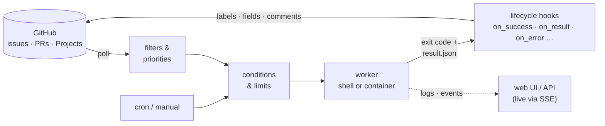

# Agent Dispatch Daemon (`adispatchd`)

[](https://github.com/brokoskokoli/adispatchd/actions/workflows/ci.yml)
[](https://www.npmjs.com/package/adispatchd)
[](https://nodejs.org/)
[](LICENSE)

**English** · [Deutsch](README.de.md) · [Website](https://brokoskokoli.github.io/adispatchd/)

**Turn GitHub issues into runs of your shell scripts and AI agents – declaratively, observably, on your own machine.**

`adispatchd` is a small, configuration-driven daemon. It finds tasks in GitHub issues and pull requests (including
GitHub Projects fields), picks them by filters and priorities, checks start conditions, runs independent shell or
container workflows in their own workspaces, supervises and logs every run, updates labels, project fields and
comments when a run starts or ends, and shows everything in a small web UI with live updates.

## Why

Running coding or review agents against an issue tracker usually ends up as a pile of cron jobs and glue scripts:
who picks which issue, what happens when an agent crashes, how do labels get reset, where are the logs?
`adispatchd` moves those decisions into a few YAML files and keeps your workers simple:

- **GitHub stays the source of truth.** There is no separate ticket store; SQLite only holds runs, locks, events,
  retry blocks and action journals.
- **Workers are plain programs.** Anything that can read environment variables and exit with a status code can be a
  worker – a shell script, a CLI agent, a container.
- **Failures are first-class.** Technical errors (crash, timeout, cancel) are kept apart from business results
  ("needs a maintainer"), each with its own hook.

## Features

- **GitHub issues and PRs as task source** – filter on labels, state, milestone, issue type, native dependencies
  ("blocked by"), the issue's work branch and PR (`work_branch`, `work_pr`, `closing_prs`) and **GitHub Projects
  fields** (status, priority, custom fields). Missing access yields `unknown` instead of a wrong start.
- **Declarative filters and named filters** – `all`/`any`/`not` trees with operators `equals`, `not_equals`,
  `contains`, `in`, `greater_than`, `less_than`; define a filter once in `filters/<id>.yaml` and reuse it in
  workflows and views.
- **Priorities** – workflow priority first, then item priority rules; global, per-workflow and per-source limits.
- **Visible start conditions** – shell checks (`conditions`, `shell_filter`) get optional names; the UI shows each
  check with its last result (ok / not now / check error, time, cache hit, first stderr line) and per planning step
  how many items passed the item checks.
- **Dashboard info tiles** – `dashboard.yaml` defines small scripts (text, number or percent with warn/critical
  thresholds) that the daemon runs in the background on a cache schedule – e.g. disk usage, open PRs, credits.
- **Triggers** – `source` (polling GitHub), `schedule` (cron with time zone) or `manual` (UI/API, with typed
  parameters).
- **Multi-source workflows** – one workflow can serve several repositories (`sources: [...]`), with per-repository
  variables such as `{source.vars.base_branch}`.
- **Lifecycle hooks** – `on_start`, `on_success`, `on_failure`, `on_crash`, `on_start_error`, `on_timeout`,
  `on_cancel`, plus **`on_result.<outcome>`** for named business outcomes and a catch-all **`on_error`** for all
  technical ends.
- **Actions** – `source.update` (add/remove labels, set **GitHub Projects fields**, adding the item to the project
  if needed), `source.comment`, and `shell` hooks; idempotent (read before write) with journal and retries.
- **Shell or container workers** – `execute.type: shell` runs a command without a shell in its own process group;
  `execute.type: container` runs a throw-away Docker or Podman container with fixed mounts, resource limits and
  `--cap-drop ALL`.
- **Token files for long runs** – short-lived GitHub App tokens as environment variable or as a file
  (`delivery: file` → `<NAME>_FILE`) that the daemon renews atomically before expiry and deletes after the run.
- **Keep files** – `execute.keep` copies transcripts and logs (glob patterns) to `runs/<run-id>/kept/` before the
  workspace is cleaned up; download them in the UI or via the API.
- **Web UI with live updates** – workflows, runs, live output, events, kept files and views (read-only tables across
  repositories), streamed via Server-Sent Events; plus a JSON HTTP API. Optional toolbar links to other local tools
  (e.g. the [claude-inspect](https://github.com/brokoskokoli/claude_inspect) dashboard), opened in a new tab or embedded
  (`ui.external_links`).
- **Dry-run** – `adispatch workflow dry-run <id>` shows which items would start and why the others would not,
  without starting anything.
- **Robust operations** – retry blocks, action retries, cancel/timeout per process group, drain, crash recovery,
  atomic config reload, and a `systemd` service installer.

## How it works



1. On every planning step the daemon polls each source, evaluates the workflow filter and sorts candidates by
   priority.
2. Start conditions (shell checks, limits, locks, retry blocks) decide whether a run may start.
3. The worker gets a workspace, a context file and – if declared – a token; its exit code and optional result file
   decide which hook runs.
4. Hooks update labels, project fields and comments on the item, so the next workflow (for example a reviewer) can
   pick it up.

## Quickstart

Requirements: Linux (production, systemd) or macOS (local), **Node.js ≥ 22.13** (24 LTS recommended; SQLite comes
from `node:sqlite`, no native add-on). Windows is not supported.

```bash
npm install -g adispatchd            # or try it without installing: npx adispatchd --help

adispatch init  --config-dir ./config --data-dir ./data   # sample configuration + scripts
adispatch start --config-dir ./config --data-dir ./data   # foreground, Ctrl-C = drain
```

Open the web UI at <http://127.0.0.1:8787/> and start the **hello** workflow (manual, no GitHub needed) under
*Workflows* – or via the API:

```bash
curl -X POST -H 'X-Adispatch-Request: 1' -H 'Content-Type: application/json' \
     -d '{"parameters":{"name":"Ada"}}' http://127.0.0.1:8787/api/v1/workflows/hello/start
```

Logs end up in `data/logs/<run-id>/`, context and result in `data/runs/<run-id>/`. To connect GitHub, create a
GitHub App per role (permissions: Issues read/write, Pull requests write, Metadata read), put its IDs into
`identities.yaml`, the repository into `sources.yaml`, export the private key
(`export GITHUB_CODER_PRIVATE_KEY="$(cat key.pem)"`), set `enabled: true` in `workflows/coder.yaml` and run
`adispatch config reload --config-dir ./config`.

For services, always install a **fixed version** globally (`npm install -g adispatchd@0.3.0`), not `npx`.

## Example workflow

A coder workflow that takes issues labelled `ready-for-coding` whose project status is `Todo` or `Ready`, moves them
across the board and returns them to the queue on any technical error:

```yaml
# sources.yaml
sources:
  app:
    type: github
    owner: example
    repository: app
    identity: maintainer
    project:
      number: 3                      # https://github.com/orgs/example/projects/3
      fields: { Status: single_select, Priority: single_select }
```

```yaml
# workflows/coder.yaml
id: coder
priority: 50                         # workflow priority comes before item priority
max_concurrent: 2
identity: coder                      # GitHub App used for labels, fields and comments
trigger: { type: source, source: app }   # or { type: schedule, cron: '0 3 * * *' } / { type: manual }
filter:
  all:
    - { field: labels, operator: contains, value: ready-for-coding }
    - { field: project.Status, operator: in, value: [Todo, Ready] }
    - { field: dependencies.blocked_by_open, operator: equals, value: 0 }
item_priority:
  rules:
    - when: { field: project.Priority, operator: in, value: [P0, P1] }
      value: 100
conditions:
  workflow: [ { name: Credits available, type: shell, command: scripts/check-credits.sh, cache: 60s } ]
execute:
  type: shell
  command: scripts/coder.sh          # relative to the config dir; no shell, args as a list
  args: ['{item.url}']
  secrets:
    GH_TOKEN: { identity: coder, delivery: file }   # renewed token file in $GH_TOKEN_FILE
  timeout: { max_duration: 6h, idle_timeout: 45m }
  keep: ['.agent/transcript.jsonl']  # saved to runs/<run-id>/kept/ before cleanup
retry: { max_technical_failures: 3 }
on_start:
  - type: source.update
    labels: { add: [coding], remove: [ready-for-coding] }
    project: { Status: In Progress }
on_success:
  - type: source.update
    labels: { add: [ready-for-review], remove: [coding] }
    project: { Status: Review }
  - type: source.comment
    message: 'Done (run {run.id}): {result.message}'
on_failure:
  - type: source.update
    labels: { add: [needs-maintainer], remove: [coding] }
on_result:                           # named outcome from the result file
  needs_split:
    - type: source.comment
      message: 'Too big, please split: {result.message}'
    - type: source.update
      labels: { add: [needs-maintainer], remove: [coding] }
on_error:                            # crashed, start_error, timed_out, cancelled
  - type: source.update
    labels: { add: [ready-for-coding], remove: [coding] }
    project: { Status: Ready }
```

Check it offline with `adispatch config validate --config-dir ./config` (errors with file:line) and preview the
selection with `adispatch workflow dry-run coder`. Setting project fields on an organisation project needs the App
permission *Organization → Projects: Read and write*. More complete examples (coder/reviewer pair, cron, manual
parameters, webhooks, multiple repositories, containers) are in the
[configuration reference §7](docs/configuration-reference.md#7-vollständige-beispiele).

## Worker protocol in brief

Details: [docs/worker-protocol.md](docs/worker-protocol.md).

- **Input:** a minimal environment (`PATH`, `HOME`, …) plus `execute.env`, declared secrets (`GH_TOKEN`, or
  `GH_TOKEN_FILE` with `delivery: file`) and `ADISPATCH_RUN_ID`, `ADISPATCH_WORKFLOW_ID`, `ADISPATCH_SOURCE_*`,
  `ADISPATCH_WORKSPACE`, `ADISPATCH_CONTEXT_FILE` (JSON context), `ADISPATCH_RESULT_FILE`. The daemon's own
  environment is not inherited.
- **Exit code = technical status:** `0` is ok, anything else is `crashed` (counts towards the retry block).
- **Business result** only via the result file (write it atomically):
  `{"schema_version":1,"result":"failure","message":"Requirements unclear"}` with `exit 0` runs `on_failure` – not a
  technical error. Without a file, exit 0 means `success`. An optional `"outcome": "needs_split"` selects
  `on_result.needs_split` instead of `on_success`/`on_failure`.
- **Events:** lines like `@@ADISPATCH_EVENT {"type":"status","message":"Running tests"}` on stdout/stderr show up in
  the UI (informational only).
- **Cancel/timeout:** SIGTERM to the process group, SIGKILL after `cancel_grace` (30 s); containers are stopped with
  `<engine> stop`.

## CLI

| Command | Purpose |
|---|---|
| `init --config-dir D --data-dir D [--port P]` | create the directory layout and a commented sample configuration |
| `start --config-dir D --data-dir D [--host H] [--port P]` | run in the foreground; SIGTERM/SIGINT = drain, then cancel-all |
| `status`, `pause`, `resume` | show state / pause and resume automatic starts |
| `drain [--wait]`, `cancel-all [--wait]` | no new runs and finish active ones / cancel all runs, then stop |
| `config validate`, `config reload` | offline validation with file:line / atomic reload of a running instance |
| `workflow dry-run <id> [--json] [--local]` | candidate selection without starting anything |
| `service install\|status\|uninstall [--dry-run]` | systemd service (Linux) |

## Documentation

> Detailed documentation is in German.

| Document | Content |
|---|---|
| [Configuration reference](docs/configuration-reference.md) | every file, field, default, filter, placeholder and the evaluation flow; examples are tested against the real loader |
| [Worker protocol](docs/worker-protocol.md) | environment, context and result files, events, token files, containers |
| [Operations](docs/operations.md) | systemd, updates, backups, recovery, reverse proxy, container permissions |
| [HTTP API / SSE](docs/api.md) | endpoints and live events |
| [Cron semantics](docs/cron-semantics.md) | schedules, time zones, missed slots, DST |
| [Changelog](CHANGELOG.md) | release notes |
| [Project status](docs/status.md) | test coverage and what is still open |
| [German README](README.de.md) | full overview incl. configuration layout, security and operations |

## Security notes

- **No authentication in V1.** The API binds to `127.0.0.1` by default. For remote access use an
  **authenticating** reverse proxy, VPN or Tailscale and list its host names in `server.allowed_hosts` (DNS
  rebinding protection). Mutating requests need the header `X-Adispatch-Request: 1`; there is no CORS.
- **Scripts and YAML are trusted code** running with the service's permissions – there is no sandbox. Write access
  to the config dir equals code execution.
- Workers and shell actions only receive explicitly declared secrets; secrets never end up in YAML (private keys only
  via environment variables), context/result files, API responses or logs (redaction in process logs is best effort).
  The only exception is the token file with `delivery: file` (`0600`, outside the workspace, deleted after the run).
- **No isolation between runs of the same service:** `0700`/`0600` only protects against other system users. All
  workers run as the same service user and can read token files and, on Linux, the environment
  (`/proc/<pid>/environ`) of parallel runs. Run high- and low-privilege workflows in separate instances under
  separate users or in containers (WI-19). With `execute.type: container` a worker only sees its own mounts; access
  to the Docker daemon is equivalent to root.

## Status and roadmap

Version 0.3.0. All planned work items are implemented and covered by an automated test suite (CI on Node 22 and 24).
Manual verification against real GitHub repositories and systemd on Linux is still pending – see
[docs/status.md](docs/status.md) for what is open before production use, and [CHANGELOG.md](CHANGELOG.md) for
release notes.

## Development

```bash
npm install
npm run check        # tsc --noEmit && vitest run
npm run test:pack    # npm pack → install → init → start → drain → update
npm run dev -- start --config-dir ./config --data-dir ./data   # without build (tsx)
```

## License

[MIT](LICENSE) © 2026 brokoskokoli
